# Agent Braid

<p align="center">
  
</p>

<p align="center"><strong>Coordinate AI coding agents on evidence, not trust.</strong></p>

<p align="center">
  <a href="https://github.com/jayanez/agent-braid/actions/workflows/validate.yml"></a>
  <a href="pyproject.toml"></a>
  <a href="ROADMAP.md"></a>
  <a href="LICENSE"></a>
</p>

<p align="center">
  <a href="pyproject.toml"></a>
  <a href="docs/tooling/README.md"></a>
  <a href="docs/tooling/NATIVE_PLUGINS.md"></a>
  <a href="docs/tooling/NATIVE_PLUGINS.md"></a>
  <a href="https://github.com/jayanez/agent-braid/tags"></a>
  <a href="docs/tooling/INSTALL.md"></a>
  <a href="docs/tooling/TELEMETRY.md"></a>
</p>

<p align="center">
  <a href="#-quick-start">Quick start</a> ·
  <a href="#-how-it-works">How it works</a> ·
  <a href="#-scientific-foundations">Scientific foundations</a> ·
  <a href="#-documentation">Documentation</a> ·
  <a href="docs/STATUS.md">Project status</a>
</p>

When several AI coding agents work on the same codebase, the hard questions are
not about any single agent. They are about how their work interacts: which
changes touch the same resources, which must happen in a given order, whether a
different order would produce the same result, and what actually happened once
the work landed. Agent hosts usually leave these questions implicit. **Agent
Braid makes them explicit, answers them with checkable evidence and keeps that
evidence after the work is done.**

It treats agent work the way concurrency theory treats operations: as actions
with declared effects on shared state, whose order matters exactly when they do
not commute. Each task is described with **Agent Interaction Metadata (AIM)** —
what it reads, writes and creates, and under which conditions — so conflicts,
dependencies and safe orderings are computed rather than guessed.

## ✨ What Agent Braid gives you

- **See interactions before they collide.** An effect graph across agent tasks
  reports exact-resource conflicts and the order they impose, and answers
  `unknown` instead of guessing when the declared information is not enough.
- **Prove whether order matters.** For small sets of immutable Git commits, every
  admissible order is replayed in isolation and the resulting trees are compared,
  so order independence is observed, not assumed.
- **Execute only what was verified and authorized.** Verified plans run through an
  owned local Git runtime with a one-use operator grant, isolated preparation,
  serial publication and recovery after interruption. Agents can propose; only an
  explicit grant executes.
- **Keep a portable record.** Every result is a versioned report that states its
  inputs, method and limits, so another person or tool can reconstruct and check
  it.
- **Work where the agents already run.** Native plugins for Codex and Claude Code
  and a bounded six-tool stdio MCP server bring the same checks into the agent's
  own loop.
- **Stay local and minimal.** The core uses only Python's standard library.
  Decision diagnostics, workload forecasting and usage telemetry are opt-in, off
  by default and never leave the machine automatically.

Beyond the core, Agent Braid includes research tools for studying agent work
itself: an offline laboratory for comparing agent-guidance variants, a closed
simulator for workloads with external effects, and evaluation contracts for
measuring real owned work. They share the same rule as everything else: none of
them can authorize execution on its own.

## 🚀 Quick start

The easiest route is the **native user plugin** for Codex or Claude Code on macOS
arm64 and Linux x86_64. It bundles Python and its dependencies, registers its
skills and guides you through selecting repositories; nothing is registered
without a preview and your explicit confirmation.

```sh
curl -fsSL https://raw.githubusercontent.com/jayanez/agent-braid/develop/install.sh \
  | sh -s -- --host codex
```

Use `--host claude` or `--host both` as needed, and add
`--ref agent-braid--v0.1.0-alpha.4` to pin a release. Git and the selected host
must already be installed. See [native installation and setup](docs/tooling/NATIVE_PLUGINS.md)
for marketplace commands, repository selection and lifecycle operations.

**Invoke the skills.** In Claude Code run `/agent-braid:analyze`, `/agent-braid:plan`,
`/agent-braid:evidence`, `/agent-braid:execute`, `/agent-braid:recover` or
`/agent-braid:setup`. In Codex select the same skills from the plugin (`$` or
`/skills`); the app-server lists them as `agent-braid:<skill>`. The plugin publishes
no MCP prompts; the portable server (`agent-braid tooling serve`) and the legacy
global install keep their `agent-braid-*` names. The
[alpha.4 acceptance record](specs/046-native-ai-plugins/release-acceptance-alpha4.md)
covers a Claude Code update, a public-tag install and a Codex CLI install, removal and
reinstall; interactive skill use and execution on Linux were not observed.

### Python installation (development and existing users)

Requires **Python 3.12+**. The analyzer and decision diagnostics use the Python
standard library. Git analysis/replay and the owned runtime also require Git;
private runtime execution is supported on Linux and macOS with POSIX file locking.
Install from source in an isolated environment:

```bash
git clone https://github.com/jayanez/agent-braid.git
cd agent-braid
python3 -m venv .venv
.venv/bin/python -m pip install --editable .
```

Analyze two included file-edit operations:

```bash
.venv/bin/agent-braid analyze examples/analysis/file-edits.json --format text
```

The relevant output is:

```text
Operations: 2  Pairs: 1
edit-readme / edit-roadmap: independent-candidate
  - Complete exact-resource footprints are disjoint.
  constraints: requires-execution-contract-before-parallelism
Execution authorization: false
```

Verify a finite replay certificate and explore the commands:

```bash
.venv/bin/agent-braid verify examples/contracts/0.2.0-draft/replay.json
.venv/bin/agent-braid --help
```

The certificate reports `verified` for two checked schedules under its stated
finite observation. Analysis and certificate verification grant no execution
permission.

**Next:** follow the [owned Git tutorial](examples/runtime/README.md) to create
two independent commits, replay them, inspect a policy, issue an exact-digest
grant and verify the resulting private tree. It needs no model, API key or
development dependency.

<a id="from-analysis-to-a-verified-private-result"></a>

## 🔀 How it works



[Open the editable Mermaid source](reports/assets/agent-braid-private-result-flow.mmd).

The advisory AIM report remains separate from the bounded Git replay path. A
consumer reconstructs replay, policy and tree claims before an operator grants
the exact plan digest. The runtime rechecks the plan, prepares in isolated
scratch and publishes checkpoints serially to a private result repository. The
checked result includes runtime state and a recovery journal; no source ref is
published. Producer and consumer share reference implementations, so
reconstruction is not independently implemented semantics.

<a id="reading-an-analysis"></a>

### Reading an analysis

A report describes evidence about the inputs and declared effects it actually
observed. `independent-candidate` means complete exact-resource footprints show
no write conflict in that domain; an execution contract is still required.
`ordered` records an explicit dependency path. `conflicting` means a shared
exact resource has a write-like effect. `unknown` means coverage or adapter
semantics do not justify a stronger result. None is an execution verdict.

Reports bind inputs, name the rule set and method, retain assumptions and
point-of-use constraints, and set `executionAuthorization: false`. See the
[analysis contract](schemas/0.1.0-alpha/analysis-report.schema.json) and
[AIM draft 0.2](docs/architecture/DRAFT_0_2.md).

<a id="cli-reference"></a>

## 🛠 Command line

The command surface is visible here; `agent-braid <command> --help` lists each
command's required artifacts, destinations and acknowledgements.

| Command | Purpose |
| --- | --- |
| `analyze`, `analyze-trace`, `analyze-git` | Analyze AIM records, explicitly mapped trace metadata, or stable Git snapshots with provenance. |
| `verify` | Verify a bounded certificate bundle. |
| `plan-git`, `verify-git`, `verify-plan` | Produce and reconstruct bounded Git replay evidence and advisory plans. |
| `prototype-git` | Compare isolated patch preparation with serial scratch integration in disposable state. |
| `propose-exchange`, `verify-exchange` | Produce and regenerate restricted anchored-sequence exchange evidence. |
| `prepare-git-run`, `execute-git-run`, `recover-git-run`, `verify-git-run` | Prepare, explicitly authorize, recover or verify the bounded local Git runtime. |
| `prepare-policy-run`, `verify-policy-plan`, `grant-policy-run`, `execute-policy-run`, `inspect-policy-run`, `recover-policy-run` | Prepare and reconstruct an operator policy, issue a digest-bound grant, then execute or inspect/recover the private result. |
| `system-one capabilities`, `system-one decide` | Inspect or run opt-in offline synthetic decision diagnostics. |
| `forecast capabilities`, `forecast predict`, `forecast advice`, `forecast inspect`, `forecast export`, `forecast serve-mcp` | Run opt-in local numeric forecasts and heuristic advice, or serve them over a read-only stdio MCP transport. |
| `telemetry status`, `telemetry report`, `telemetry export`, `telemetry merge`, `telemetry purge` | Inspect, move or clear default-off local numeric telemetry. |
| `plugin setup`, `plugin discover`, `plugin doctor`, `plugin workspaces`, `plugin serve` | Configure and diagnose the native user plugin and its workspace registry. |
| `tooling` | Experimental portable local AI tooling surface. |

The analyzer/runtime contract is `0.1.0-alpha`; AIM and certificate contracts
are `0.2.0-draft`; the package version is `0.1.0a1`. The public CLI does not
expose source-ref promotion, arbitrary repository code execution, or provider
calls through the owned runtime.


## 🧪 Scientific foundations

Agent Braid is also a research programme with a clear question. It draws on
algebraic models of concurrency — commutation, confluence and the
order-independence of independent actions — and takes inspiration from the
**Yang–Baxter equation**, which characterises when different orderings of pairwise
exchanges lead to the same outcome. The project does **not** assume that such
structure exists in AI agent work: it investigates which classes of agent
interactions admit it, starting from finite, checkable cases such as the
`anchored-sequence-v1` structured exchange and its bounded braid-relation
controls. Yang–Baxter is a source of **inspiration** today, not a proved theorem
about agents.

Every claim is earned by defining its objects, operators, equivalence relation,
domain and evidence. Claims distinguish analogy, hypothesis, heuristic, empirical,
exhaustive-finite and formal results. Finite replay and structural checks support
only their declared domains; they establish neither production safety,
hidden-effect completeness, general confluence nor a general Yang–Baxter theorem.
Assurance labels are [compatibility classes](docs/architecture/ASSURANCE_LEVELS.md),
with the property, method, observation and execution contract stated separately. Results are tied to frozen candidates, and negative results are
published alongside positive ones: the runtime evaluation, for example, did not
demonstrate a useful parallel speedup, and the project says so. The
[Constitution](CONSTITUTION.md) is the normative authority; start with
[claim discipline](docs/theory/CLAIM_DISCIPLINE.md),
[operational semantics](docs/theory/OPERATIONAL_SEMANTICS.md),
[structured exchange semantics](docs/theory/STRUCTURED_EXCHANGE.md) and the
[mathematical foundations](MATHEMATICAL_FOUNDATIONS.md).

## 📚 Documentation

| Your next step | Start here |
| --- | --- |
| Build and verify a local result | [Owned Git tutorial](examples/runtime/README.md) · [Installation](docs/tooling/INSTALL.md) |
| Use it from Codex or Claude Code | [Native plugins](docs/tooling/NATIVE_PLUGINS.md) · [AI tooling guide](docs/tooling/README.md) |
| Understand architecture and limits | [Architecture](ARCHITECTURE.md) · [Git replay](docs/architecture/GIT_REPLAY.md) · [ADRs](docs/adr/) |
| Consume portable artifacts | [AIM](docs/architecture/AGENT_INTERACTION_METADATA.md) · [Certificates](docs/architecture/CONFLUENCE_CERTIFICATE.md) · [Schemas](schemas/) |
| Turn on optional local diagnostics | [Telemetry](docs/tooling/TELEMETRY.md) · [Forecast operations](docs/forecast/OPERATIONS.md) |
| Reproduce experiments | [Bounded laboratory](research/lab/README.md) · [Experiment protocol](docs/experiments/PROTOCOL.md) · [External reproduction](docs/releases/EXTERNAL_REPRODUCTION.md) |
| Explore the research programme | [Research](RESEARCH.md) · [Mathematical foundations](MATHEMATICAL_FOUNDATIONS.md) · [References](research/REFERENCES.md) |
| Follow progress and direction | [Project status](docs/STATUS.md) · [Roadmap](ROADMAP.md) · [Open-tooling strategy](docs/strategy/OPEN_TOOLING_STRATEGY.md) |
| Contribute under the project rules | [Contributing](CONTRIBUTING.md) · [Governance](GOVERNANCE.md) · [Terminology](TERMINOLOGY.md) |

## 🤝 Contributing

Contributions are welcome in bounded adapters, reproducible controls,
counterexamples, interoperability, concurrency semantics, Git internals and
precise documentation. Read [CONTRIBUTING.md](CONTRIBUTING.md) for the
development setup and validation profiles, and use [SECURITY.md](SECURITY.md) to
report vulnerabilities.

```bash
.venv/bin/python -m pip install -r requirements-dev.txt -r requirements-speckit.txt
.venv/bin/python -m scripts.restore_public_spec_history
.venv/bin/python -m scripts.validate_change --base develop --profile quick
```

<details>
<summary><strong>Repository map</strong></summary>

```text
agent_braid/   Analyzer, Git replay, structured exchange, private runtime and MCP
docs/          Architecture, ADRs, operational guides, theory and release records
examples/      Portable fixtures, positive/negative controls and runtime tutorial
research/      Finite laboratory, hypotheses, benchmarks, counterexamples and radar
schemas/       Versioned machine-readable contracts
scripts/       Validation, capture, reproduction, profiling and tracking tools
specs/         Feature plans, frozen evidence, assurance and review records
```

</details>

<a id="citation-and-licensing"></a>

## 📄 Citation and licensing

Cite the relevant release or frozen evidence record alongside the repository;
machine-readable metadata is in [CITATION.cff](CITATION.cff).

Copyright © 2026 Juan Antonio Yáñez García. Software, schemas, executable examples
and automation use [AGPL-3.0-only](LICENSES/AGPL-3.0-only.txt); documentation and
research use [CC-BY-SA-4.0](LICENSES/CC-BY-SA-4.0.txt). The [license map](LICENSE),
[attribution notices](NOTICE) and [trademark policy](TRADEMARKS.md) define the
applicable terms and project identity.
