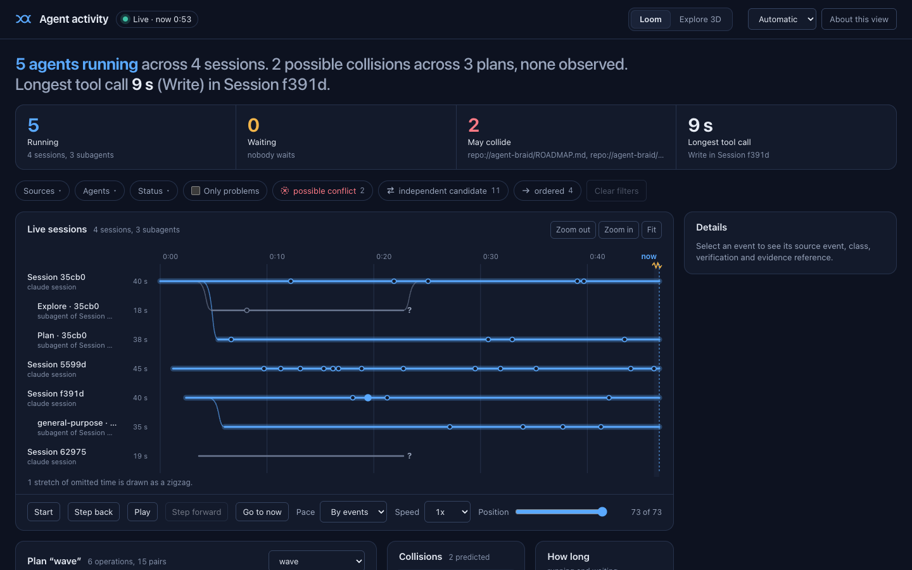

<!-- SPDX-License-Identifier: CC-BY-SA-4.0 -->
# Activity viewer

**Status:** SPEC-061 VIS.1a with the VIS.1d dashboard (2026-11-05), a read-only
viewer of Agent Braid coordination artifacts and Claude Code hook events. It is a companion that ships with this
repository and its Python package; the native plugin (`integrations/agent-braid/`)
contains none of its code. See [SPEC-061](../../specs/061-activity-viewer/spec.md),
[ADR 0032](../adr/0032-activity-viewer-companion.md) and
[ADR 0033](../adr/0033-vendored-threejs-mit-boundary.md). The viewer reports what was
observed or declared. A shape, label, counter or compatibility class on the page is
**not a guarantee**, not a safety ordering and not permission to run, schedule or
interleave work: every event carries `executionAuthorization: false`.

## What it is and is not

- **Loopback only.** `view serve` binds `127.0.0.1` and no command-line option chooses
  another address. It makes no outbound connection and keeps no access log.
- **Read-only.** No page, route or key runs, schedules, grants or writes anything. It
  never writes to a repository, a plugin registry, a run directory or host
  configuration. The one file it writes is its own ingest token, in a private runtime
  directory; it is kept when the viewer stops and reused at the next start.
- **Observational hooks.** It answers Claude Code hooks with an empty body and never
  takes part in a host decision.
- **No effort measurement yet.** Codex and OpenTelemetry ingest, token and effort
  views, recording and export are **VIS.1b** and are not available. When they arrive,
  effort stays ephemeral (held in memory only), recording is explicit (`--record`),
  the default export is minimal, effort figures are labelled `host-estimate`, and no
  page or export claims a speedup. None of that exists in this release.

## Install

From a source checkout the viewer reads its web bundle from
`integrations/agent-braid-view/web`:

```bash
python3 -m agent_braid view serve
```

From a built wheel the build ships the same bundle, with the vendored Three.js files
and their manifest, inside the package (`agent_braid/view_assets/web`), so
`agent-braid view serve` works without a checkout:

```bash
python3 -m pip install /absolute/artifacts/agent_braid-0.1.0a2-py3-none-any.whl
agent-braid view serve
```

The viewer needs Python 3.12 or newer and uses only the standard library. The page opens on the dashboard and its
live loom, which need no WebGL; a browser with WebGL2 is needed only for the optional Explore 3D view.
The page language follows the browser or desktop-app locale, then the locale of the terminal that started
`view serve` (sent to the page as a bare `es` or `en`), then English; a manual choice overrides it. Three.js r186 is vendored under
`integrations/agent-braid-view/web/vendor/` with its licence and a hash manifest; the
page never loads code from another origin.

## Commands

```text
agent-braid view serve    [--replay FILE] [--watch DIR ...] [--no-discover]
                          [--port N] [--surface web] [--runtime-dir DIR]
agent-braid view open     [--port N] [--runtime-dir DIR]
agent-braid view validate FILE
agent-braid view env      --host claude [--port N] [--runtime-dir DIR]
```

### `view serve`

Starts the viewer and prints, once, the loopback address to open
(`http://127.0.0.1:<port>/open?code=...`), the owner-only ingest token file and any
watched roots. Open the printed address in a browser; the single-use code is
exchanged for a read-only session cookie named `braid_view_<port>`, so two viewers on
loopback keep separate sessions. Stop it with Ctrl-C or SIGTERM. The token
file is kept and reused at the next start while it is still a safe owner-only file, so
hosts that read it once keep working after a restart; the start text says
`Ingest token: reused ...` or `Ingest token: new ...` (only a new token needs a host
restart).

| Option | Effect |
|---|---|
| `--replay FILE` | Load a recorded loom JSONL stream (`agent-braid-loom/v0.1`) before serving. A stream that does not validate is refused with exit code 1 and nothing starts. Replayed events are shown as unverified. |
| `--watch DIR` | Poll a directory for known artifacts (repeatable, at most 8 roots). Replaces automatic discovery. |
| `--no-discover` | Without `--watch`, do not look for roots in the plugin registry. |
| `--port N` | Loopback port, 0 to 65535. The default `0` lets the operating system choose one. (`view env --port` takes 1 to 65535: the port `serve` printed.) |
| `--runtime-dir DIR` | Absolute path of the private directory (mode 0700) for the ingest token. The default is `$XDG_RUNTIME_DIR/agent-braid-view`, else `~/.local/share/agent-braid-view`. |
| `--rotate-token` | Replace the ingest token instead of reusing it. Restart Claude Code (or export the variable again) afterwards. |
| `--surface S` | `web` is the only implemented surface. `mod`, `tui` and `mcp-app` report that they are planned and start nothing. |

**Watched artifacts.** `--watch` and discovery read only files with these exact names,
anywhere under a root: `analysis.json`, `git-replay-plan.json`,
`scheduler-preparation.json`, `operator-grant.json`, `state.json`, `hazard-notice.json`,
`ownership-receipt.json` and `gate-result.json`. Every other name is ignored. Each
artifact is read through its adapter and re-hashed (shown as verified by this session).
A symbolic link, a non-regular file or a path leaving its root is never read. The
watcher polls every 500 ms and is bounded: 4,096 directory entries per scan, 16 MiB per
file. When a bound is exceeded the viewer stores a visible gap instead of failing.

**Automatic discovery.** When neither `--watch` nor `--no-discover` is given, `serve`
reads the plugin registry (read-only, no lock, no write) and watches the private result
root of each registered workspace, so the viewer shows the plugin's `analyze-work`
reports without configuration. Only existing directories private to the user are kept.
A missing or invalid registry, or a result root that does not exist yet (restart the
viewer after the first analysis), is a note at start, never a failure.

**Private report copies.** Each successful `analyze-work` call of the plugin keeps a
local copy of its report in the workspace's result root as `analysis-<utc stamp>-<id>/analysis.json`,
for the viewer's watcher. Copies are private to the user (directories 0700, files 0600),
never uploaded, removed after 30 days, and removed oldest first beyond 64 MiB or 1,500
copies. The viewer reads copies newest first, so when a store limit is reached the oldest
copies are the ones left out, and a `stream-truncated` gap says so. A failure to write a
copy never changes the `analyze-work` result. See [plugin privacy](PLUGIN_PRIVACY.md).

**Root labels.** The page never shows a path. Each watched root gets a stable label,
`root 1` to `root 8`, in start order, and the start banner lists the mapping so you can
tell which directory a label stands for:

```text
Watching result roots discovered from the plugin registry (read-only); the page shows only these labels:
  root 1: /absolute/path/of/the/first/result/root
  root 2: /absolute/path/of/the/second/result/root
```

**Hooks.** `serve` accepts Claude Code HTTP hooks at `/hook/claude` for
`SessionStart`, `SessionEnd`, `SubagentStart`, `SubagentStop` and `PostToolUse` only.
Decision events are refused. The viewer keeps an allowlist of payload field names and
drops every other field. A session or subagent that was shown as closed stays closed: if
Claude Code keeps sending events for it, the page shows
one gap naming that strand instead of new activity, so the missing activity is not mistaken
for none.

### `view open`

Prints a new single-use link to the viewer that is already running, so you can open it
in another browser without a restart. Browsers that opened it earlier stay connected,
and the history in memory is kept. The link is valid for 120 seconds and works once.
The command reads the viewer's owner token from `<runtime dir>/view-owner-<port>`, a
file the viewer creates with mode 0600 at start and removes when it stops. The token
is never printed. With more than one viewer running, pass its `--port`; `--runtime-dir`
is as for `serve`. The page itself never creates links.

### `view validate FILE`

Checks a recorded loom stream against the event contract and writes nothing. It prints
`ok: N events` on success.

### `view env --host claude`

Prints observational command hook settings for you to merge into your user-level
Claude Code settings (`~/.claude/settings.json`). **It writes nothing**, contains no
credential and names only the observational hook events above. Each hook runs a short
stdlib Python command (the interpreter that ran `view env`) that reads the ingest token
from its owner-only file at every call and posts the hook payload to the loopback port
with proxies disabled; the token never appears in the settings, in process listings, in
the environment or in output. The command prints nothing and always exits 0, so it never
affects Claude Code. No environment variable is needed, so the hooks also work in the
Claude desktop app and IDE launches; an `export AGENT_BRAID_VIEW_TOKEN=...` line left in
your shell profile by an earlier version is unused and can be removed. Start `view serve`
first and pass its port with `--port`; with the viewer stopped, another process on that
port would receive the payloads. Because the file is read at every call, a new token
(`Ingest token: new`) needs no Claude Code restart. If you reinstall Agent Braid under
another Python, print and merge the hooks again. `--host codex` is accepted and reports that it is not available yet.

### Exit codes

| Code | Meaning |
|---|---|
| 0 | Success. |
| 1 | A stream was read but is invalid (`validate`, or `serve --replay`). |
| 2 | Usage error, refusal or unavailable resource: a bad option, a planned `--surface`, a missing file, an unusable bundle or runtime directory, a port that cannot be bound. A refusal leaves nothing behind. |

## Reading the page



The page is a dashboard read from top to bottom. Every view, panel, tile and table row
drives the same selection and filters, and the URL hash keeps them.

**App bar.** The live badge says `Live · now m:ss` while the event stream is connected,
`Not live · last update m:ss` when it is lost (the page cannot know what happened
since), and `Replay · not live` for a replay. Next to it are the connection state, the
Loom and Explore 3D switch, the language and About.

**Now sentence and KPI tiles.** One sentence answers who is running, who waits on whom,
what may collide and the longest stated tool call. Each noun in it selects its agent or
pair. The tiles (Running, Waiting, May collide, Longest tool call; Planned operations
when nothing is live) apply their filter when clicked. There is no "collided" tile:
no source of observed collisions exists yet, and the page shows no zero it cannot back.

**Filters.** Sources, Agents and Status menus, "Only problems", one chip per pair class
and Clear filters. A hidden source is counted inside the Sources menu and stays in the
counters, so a hidden source never looks like an absent one.

**Live loom.** One thread per Claude Code session, on a real time axis; subagents branch
off their session. A running thread glows, a waiting one is dotted with a tether to what
it waits on, a finished one is muted. Tool calls are beads; a duration is shown only when
the host stated it, live only. Lanes are named `Session 7f3ab` or `Explore · 7f3ab`: a
short, salted id that is stable while the viewer runs. Untimed analysis plans are never
drawn on this axis.

**Plan map.** One analysis report at a time (choose it in the panel): operations in
columns by their declared waits, and pairs drawn as "may collide", "must wait",
"independent" or "unknown". It has no time axis and states no order of execution.
The Collisions panel lists predicted pairs; the How long panel shows running and waiting
per lane.

**Details rail.** The selected event, its class, verification and evidence reference. On
a phone it becomes a bottom sheet with a close button.

**Playback.** Docked under the loom: step through events or play them by events or in
real time; "Go to now" returns to the end and follows new events.

**Explore 3D.** The same lanes in depth: time on x, lanes across, with Side, Top and
Isometric presets, Frame all (F), Fly to selected (G or double click) and Lock scene.
Class words appear on hover or selection only.

**Tabs.** Events (the complete text alternative of the views), Summary, Legend and Help.
Playback reveals events in model order. Counters and absence markers always cover every
retained event (at most 50,000, with evicted ranges shown as gaps).

## Host verification status

The surfaces matrix ([contract](../../specs/061-activity-viewer/contracts/surfaces-matrix.json))
changes status only from an owner-run host-verification receipt
([runbook](../../specs/061-activity-viewer/host-verification-runbook.md)). Current
VIS.1 rows:

| Host | Client | Surface | Status |
|---|---|---|---|
| claude-code | desktop | web | verified |
| claude-code | terminal | web | verified |
| codex | cli | web | hv-pending |
| codex | desktop | mcp-app | hv-pending |

`verified` here is narrow: Claude Code 2.1.292 delivered hooks and OpenTelemetry under
`claude -p` only, and the desktop browser pane loaded a loopback fixture page; the real
viewer is opened again at the T035 checkpoint. Codex remains pending: its token-usage
names are unobserved, and MCP Apps rendering may record `unobserved`.

## Limits

The viewer makes no claim about what a host did beyond the events it received, and a
missing event is not evidence that nothing happened. Local unit tests and a fresh-clone
validation back this guide; they do not replace the owner's check of the viewer on real
sessions (the T035 go/no-go checkpoint for VIS.1b).
